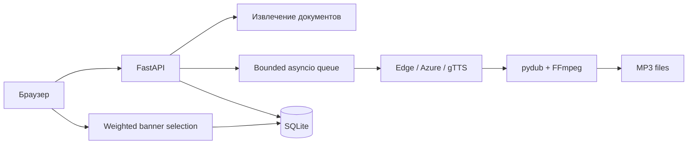
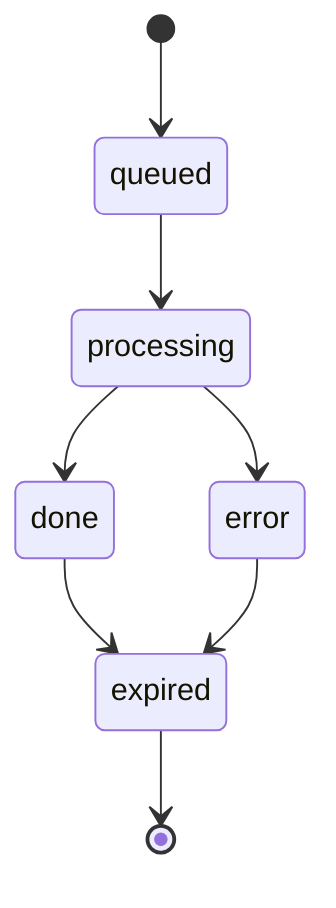
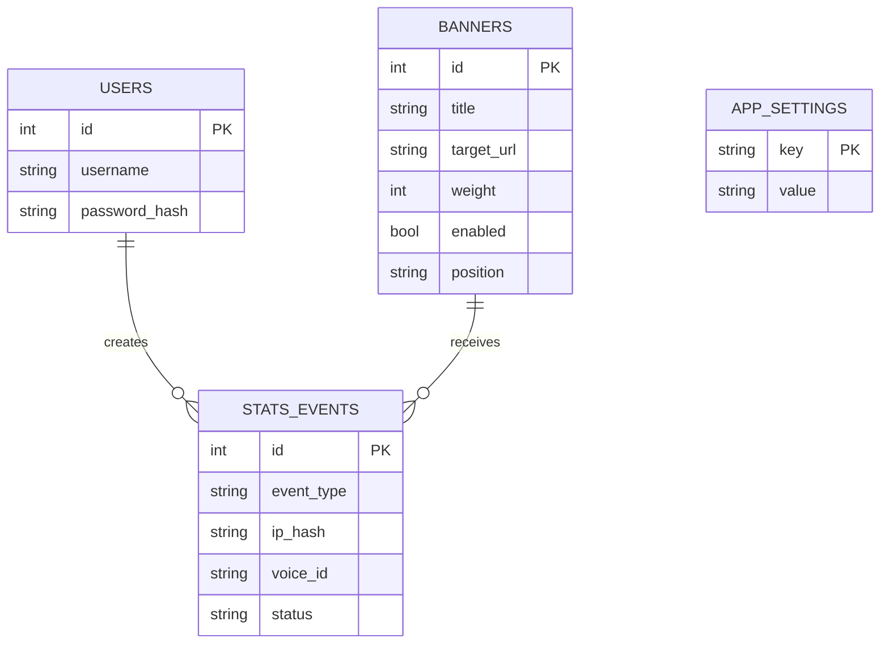

# Architecture

Voice Box is a single-process FastAPI application with a server-rendered web client, an in-memory bounded work queue, SQLite persistence for users/advertising/metrics, and pluggable speech engines.

    Browser -> FastAPI routes -> TXT/PDF/DOCX/EPUB extraction -> asyncio queue
    asyncio queue -> Azure MAI / Edge Neural / gTTS -> pydub + FFmpeg MP3 merge -> output/{job_id}.mp3
    Browser -> weighted ad selector -> SQLite

## Request lifecycle

1. The API checks upload size, extracts text and validates the selected voice and limits.
2. It stores a job in the bounded asyncio queue; status exposes progress and errors.
3. A worker splits text at sentence/paragraph boundaries, synthesizes parts through the selected engine, merges audio and exports MP3.
4. The browser polls status and gets a player/download link. Successful and failed work is logged to SQLite.

Queue state is in memory, so active jobs do not survive process restarts and multiple app replicas do not share work. Use a persistent external queue before horizontal scaling. Generated audio currently has a one-hour TTL target in settings; cleanup must run as a managed task before production use.

## Reading quality

Edge Neural is the default free engine and gTTS is a basic fallback. Edge standard voices do not expose emotional speaking styles. When Azure Speech credentials are configured, MAI-Voice-2.1 Russian voices expose reflective/serious styles through SSML. This requires an Azure subscription and can incur usage charges. No TTS engine guarantees human performance; preview voices before long synthesis.

## Data and security

SQLite stores administrator credentials, events and banner campaigns in data/voicebox.db. Uploaded banner assets are served from data/banners. Book uploads are held in memory during extraction and not persisted. Admin API routes require the signed session cookie. Configure strong SECRET_KEY, ADMIN_PASSWORD, IP_HASH_SALT and HTTPS_ONLY for deployment. Rate limiting is currently process-local.

## Диаграмма компонентов

## Жизненный цикл задачи

## Схема данных

## Наследие прототипа

Прежний prototype был минимальным gTTS сервисом с POST /synthesize, GET /status/{job_id}, GET /audio/{filename}, очередью на один worker и TTL около часа. Он не содержал надёжной маршрутизации к Edge, а preview был жёстко привязан к gTTS. Каталог prototype удалён после переноса рабочего сценария в app/.
